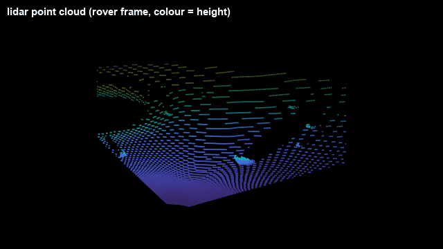

# UnrealLidarCam

A lidar for Unreal Engine 5 with a free beam pattern (horizontal and vertical
aperture, beams per axis), measured on the GPU or by line traces, streamed to
ROS over TCP.

*The rover driving toward a crater in MARE: the camera, the
ground-truth depth, and the lidar scan seen from above and behind the rover.
Depth and lidar share the colour scale (distance, 2–40 m); the crater is the
ring the scan lines break around, with the rock in front of it.*

Part of [MARE](https://github.com/raulcastar/MARE-Lunar-Simulator), an open-source lunar rover
simulation suite. In its ROS 2 stack,
[GNC-Moon-Simulator](https://github.com/raulcastar/GNC-Moon-Simulator), the `component_lidar` node publishes the scans as a `PointCloud2` on
`lidar/points` (port 3007).

## Requirements

Unreal Engine 5.7 on Windows (the version it is developed and tested with).
Building from source also needs Visual Studio 2022 with the *Game development
with C++* workload.

On the ROS side: ROS 2 Jazzy (Ubuntu 24.04), with the
`component_lidar` node of GNC-Moon-Simulator receiving the stream. The plugin itself has no ROS
dependency: any program that reads the [wire format](docs/wire-format.md) can use it.

## Install

- **Prebuilt (UE 5.7, Win64):** download `UnrealLidarCam-<version>-UE5.7-Win64.zip`
  from [Releases](https://github.com/raulcastar/UnrealLidarCam/releases) and extract it
  into `<YourProject>/Plugins/`.
- **From source:** clone this repository into `<YourProject>/Plugins/UnrealLidarCam`,
  open the project and answer **Yes** to rebuild the module.

Then check it is enabled under *Edit → Plugins → Project → Other*.

## Use

1. Add an **Unreal Lidar Cam** component to the rover and attach it under a
   camera (it scans along that camera's view).
2. Set the aperture and beams in *Details → Lidar*.
3. Press Play: scans go to `127.0.0.1:3007`.

## Dependencies

None to build or run: only engine modules. It stamps its data with the shared
simulation time (its own copy of `GncSimTime.h`); add
[UnrealSimClock](https://github.com/raulcastar/UnrealSimClock) so ROS gets `/clock` on the same time base.

## Docs

| | |
|---|---|
| [Setup in detail](docs/setup.md) | Attaching it, following a camera |
| [Settings and scan modes](docs/settings.md) | Every setting; GPU and CPU modes |
| [In ROS](docs/ros.md) | The published point cloud |
| [Wire format](docs/wire-format.md) | The TCP packet layout |
| [Making a release](docs/release.md) | Building the prebuilt zip for GitHub releases |

## License

[MIT](LICENSE), © 2026 Raul Castilla Arquillo.
